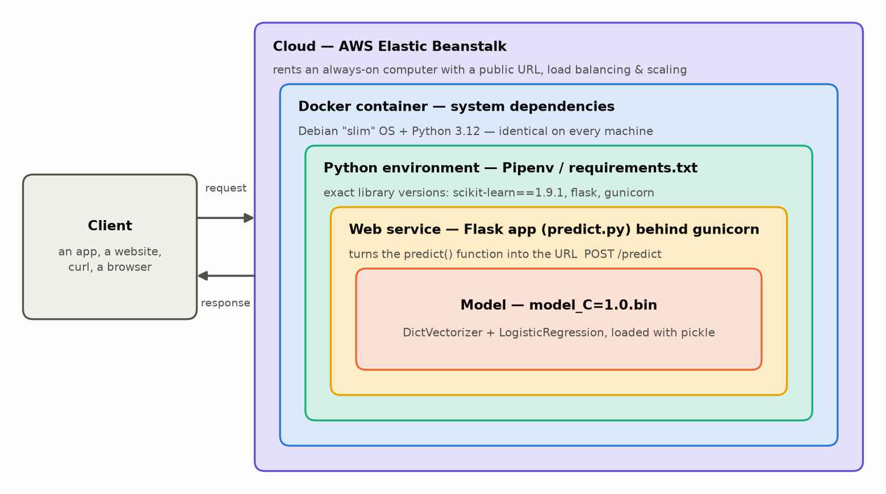
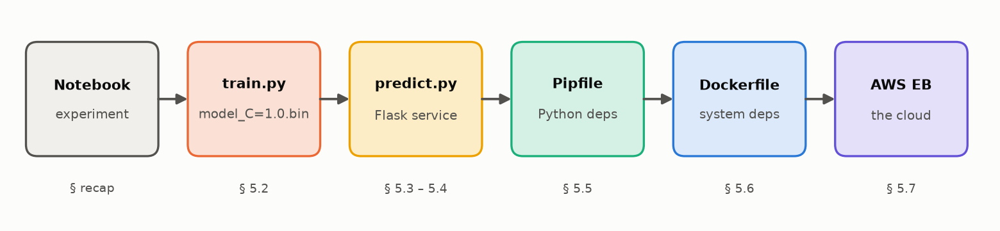
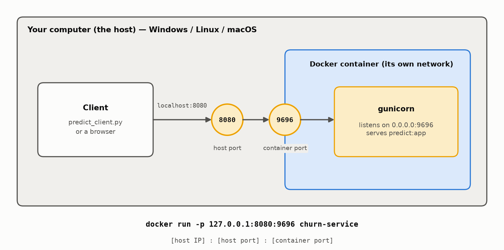

# 🚀 Deploying a Machine Learning Model: Customer Churn Prediction

An end-to-end example of taking a trained model **out of a Jupyter notebook and into production**:

**`pickle` → Flask → Pipenv → Docker → AWS Elastic Beanstalk**

A telecom company wants to know which customers are about to leave (*churn*) so it can send them a
discount in time. A logistic regression trained on the
[Telco Customer Churn](https://www.kaggle.com/datasets/blastchar/telco-customer-churn) dataset
(test AUC **0.858**) is served as a web service: send a customer as JSON, get back the churn
probability.



📓 **The full walkthrough, with explanations, diagrams and plots, is in
[`model_deployment.ipynb`](model_deployment.ipynb).**

---

## Contents

| § | Topic | You'll learn |
|---|-------|--------------|
| 1 | What is deployment? | the layers of a deployed model |
| 2 | Recap: training the churn model | data prep, K-fold validation, ROC curve |
| 3 | Saving and loading the model | `pickle`, turning a notebook into scripts |
| 4 | Web services & Flask | HTTP methods, status codes, `localhost`, a ping/pong app |
| 5 | Serving the model with Flask | `POST /predict`, `requests`, gunicorn vs waitress |
| 6 | Virtual environments: Pipenv | `Pipfile` vs `Pipfile.lock`; venv / conda / poetry / uv compared |
| 7 | Docker | images vs containers, Docker vs VMs, the Dockerfile, port mapping |
| 8 | AWS Elastic Beanstalk | deploying to the cloud, load balancing, auto-scaling |
| 9 | Summary & explore more | FastAPI, uv, other clouds |



## Project structure

```
.
├── model_deployment.ipynb   # the walkthrough notebook
├── train.py                 # train the model -> model_C=1.0.bin
├── model_C=1.0.bin          # trained DictVectorizer + LogisticRegression (pickle)
├── predict.py               # Flask web service: GET / (health), POST /predict
├── predict_client.py        # client: sends customer.json to the service
├── predict_offline.py       # score one customer without a web service
├── ping.py                  # minimal Flask example (/ping -> pong)
├── customer.json            # example request body
├── Pipfile / Pipfile.lock   # Python environment (Pipenv)
├── requirements.txt         # pinned packages for the Docker image
├── Dockerfile               # how to build the service image
├── .dockerignore / .ebignore
├── notebook_helpers.py      # plot style, diagrams, background server for the notebook
├── data/
│   └── churn_telco_data.csv
└── images/                  # diagrams (generated by notebook_helpers.py)
```

## Quick start

### 1. Set up the environment

```bash
pip install pipenv
pipenv install --dev          # creates the env from Pipfile.lock
```

### 2. Train the model (optional, `model_C=1.0.bin` is included)

```bash
pipenv run python train.py
```
```
C=1.0  AUC = 0.842 +- 0.007
Test AUC = 0.858
Model saved to model_C=1.0.bin
```

### 3. Run the service locally

```bash
# Linux / macOS
pipenv run gunicorn --bind=0.0.0.0:9696 predict:app

# Windows (gunicorn doesn't run on Windows)
pipenv run waitress-serve --listen=0.0.0.0:9696 predict:app
```

In a second terminal:

```bash
pipenv run python predict_client.py
```
```
POST http://localhost:9696/predict
Response: {'churn': True, 'churn_probability': 0.6278927307895446}
Churn probability 62.8% -> send a discount offer
```

### 4. Run it with Docker

```bash
docker build -t churn-service .
docker run -it --rm -p 9696:9696 churn-service

python predict_client.py --host localhost:9696
```



### 5. Deploy to AWS Elastic Beanstalk

Needs an AWS account and access keys; the EB CLI is installed as a dev dependency.

```bash
pipenv shell
eb init -p docker -r eu-north-1 churn-serving
eb create churn-serving-env
eb status                                   # shows the public URL (CNAME)

python predict_client.py --host <your-env>.elasticbeanstalk.com

eb terminate churn-serving-env              # ⚠️ delete it when done to stop the costs
```

## API

| Method | Path | Body | Response |
|--------|------|------|----------|
| `GET` | `/` | – | `{"status": "ok"}` (health check) |
| `POST` | `/predict` | one customer as JSON (see [`customer.json`](customer.json)) | `{"churn": true, "churn_probability": 0.628}` |

```bash
curl -X POST -H "Content-Type: application/json" -d @customer.json http://localhost:9696/predict
```

*(In Windows PowerShell, type `curl.exe` instead of `curl`.)*

## Tech stack

Python 3.12 · pandas · scikit-learn 1.9.1 · Flask · gunicorn / waitress · Pipenv · Docker · AWS Elastic Beanstalk · matplotlib

## Acknowledgements

Based on module 5 (*Deploying Machine Learning Models*) of
[ML Zoomcamp](https://github.com/DataTalksClub/machine-learning-zoomcamp) by DataTalks.Club.
Dataset: [IBM Telco Customer Churn](https://www.kaggle.com/datasets/blastchar/telco-customer-churn).
